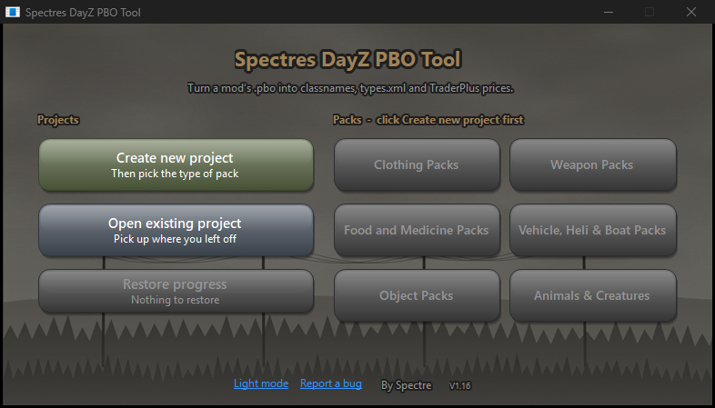
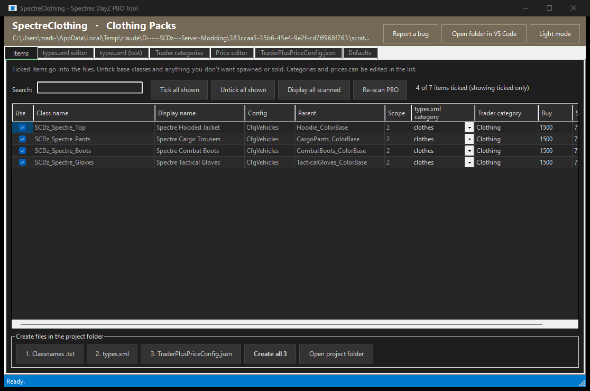
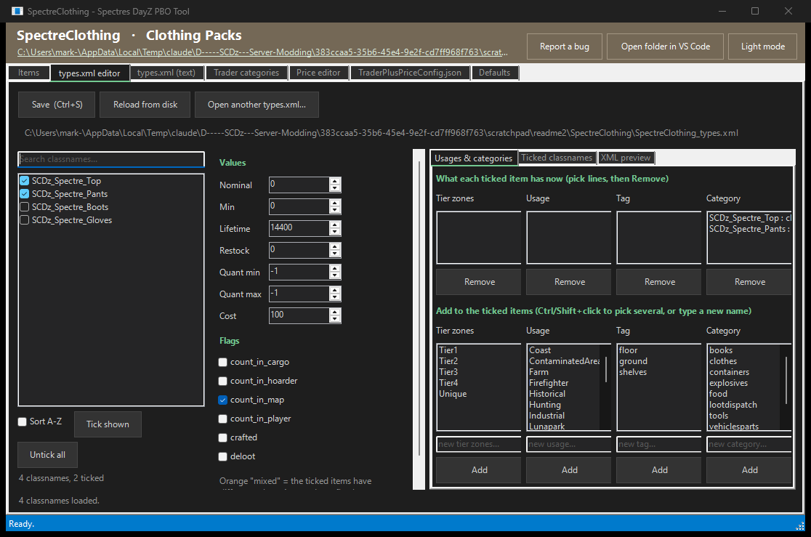
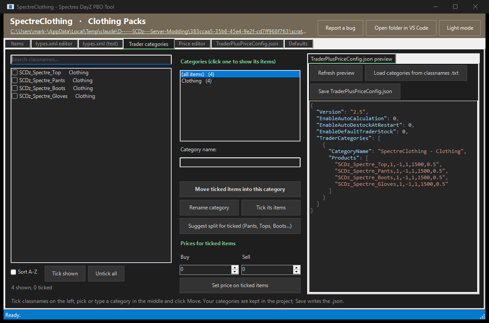
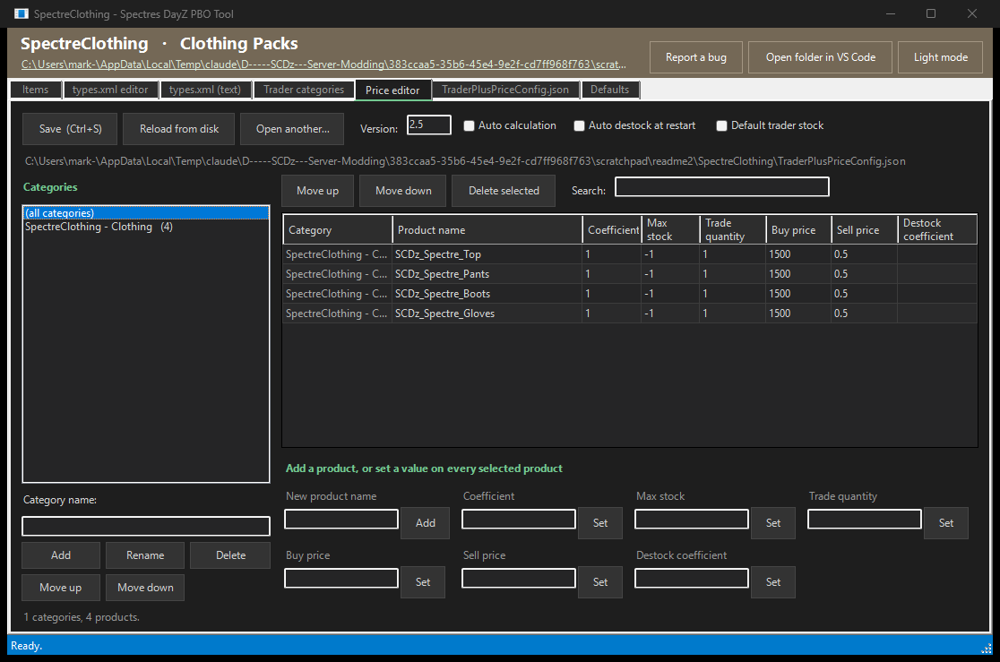

# Spectres DayZ PBO Tool

**A free tool for DayZ server owners, by Spectre.**

Open a mod's `.pbo` file (or its whole `Addons` folder) and the tool reads every item in it, then builds a project folder with your
classnames list, a `types.xml`, and TraderPlus price files. All of them are ready to edit in the tool and paste into your server.



## Download

1. Go to [**Releases**](../../releases/latest) and download `Spectres.DayZ.PBO.Tool.Setup.V1.xx.exe`.
2. Run it. It installs just for you (no administrator rights needed) and adds a desktop shortcut and a Start menu folder.
3. Windows may show **"Windows protected your PC"** because the tool is new and not code-signed. Click **More info**, then
   **Run anyway**.

Works on Windows 10 and 11. Nothing else needs installing. To remove it, use **Settings > Apps** or the Uninstall shortcut in the
Start menu. Your projects and settings are never deleted.

### Check your download (optional)

Each release lists a SHA-256 checksum. To check that your file matches, open PowerShell in your Downloads folder and run:

```powershell
Get-FileHash ".\Spectres DayZ PBO Tool Setup V1.16.exe" -Algorithm SHA256
```

The value it prints should be the same as the one on the release page.

## What it makes

Pick **Create new project**, choose the pack type, then pick the mod's `.pbo` or `Addons` folder. The project folder gets:

| File | What it's for |
|---|---|
| `{Mod}_classnames.txt` | Every item classname, grouped under `//{Mod} - {Category}` headings |
| `{Mod}_types.xml` + `{Mod}_ce` folder | A starting types layout, plus a mission-ready `_ce` folder and the `cfgeconomycore.xml` line to paste |
| `TraderPlusPriceConfig.json` | TraderPlus categories and prices for every item |
| `TraderPlusIDsConfig.json` | Optional, offered after the price config so a trader can sell the new categories |

Base classes are left out automatically. Only items the game can actually spawn (`scope = 2`) are ticked, and you can tick or untick
anything yourself.



### Extras for each pack type

- **Vehicle, Heli & Boat packs:** `TraderPlusVehiclesConfig.json` with every part each vehicle needs, `spawnabletypes`, and an
  `events.xml` entry. Vehicles are listed first, then their parts.
- **Weapon packs:** `spawnabletypes` for every weapon, with its optics, suppressors, magazines and other attachments from the mod.
- **Animal & Creature packs:** an `Ambient...` or `Infected...` event in `events.xml`.
- **Clothing, Food & Medicine, and Object packs:** the main files above.

## Editors built in

- **types.xml editor:** tick any number of items, then set nominal, min, lifetime, restock, flags, tiers, usages, tags and categories
  for all of them at once. It can open any server's types.xml too.

  

- **Trader categories:** move items between TraderPlus categories, rename them and set prices.

  

- **Price editor:** edit `TraderPlusPriceConfig.json` like a spreadsheet. Every save keeps a dated copy in the project's `Backups` folder.

  

- Text editors for the XML and JSON files with VS Code-style colours, Find, and a syntax check.
- Light and dark mode.
- **Live backup:** unsaved edits are copied every 15 seconds. If the tool or your PC closes unexpectedly, click **Restore progress**
  on the start window.

[Visual Studio Code](https://code.visualstudio.com/) is a handy free companion. The tool can open your project folder in it, but it isn't required.

## Found a bug or have an idea?

Click **Report a bug** in the tool. It fills in the tool version, Windows version and any recent errors for you, then opens a new
issue here so you can check it and submit. You can also open an issue yourself on the [**Issues**](../../issues) page.

Ideas for new features are welcome too.

---

Made by **Spectre** for the DayZ server community. Free to use.
